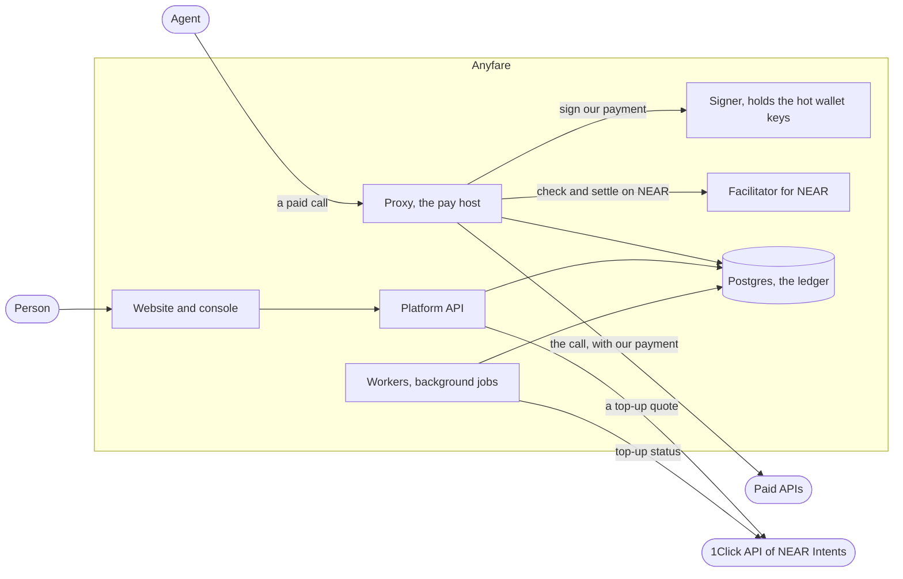

# Architecture

**What this is.** How Anyfare is built: the apps, the path of a call, and where the money is.

**For whom.** Anyone who reads or changes the code. Judges who want to see what NEAR does.

What is not built is marked "Not built".

## One example

An agent has a NEAR account with 5 USDC. It wants a price from an API that takes only USDC on Base, $0.01 a call. These numbers are made up; the steps are real.

1. The agent calls `https://pay.anyfare.agents.bakingbad.dev/api.example.com/v1/price`.
2. We call the API with no payment and read its `402`: $0.01, USDC on Base.
3. We answer the agent with our own `402`: $0.01 in USDC on NEAR, Base or Solana, over MPP on Tempo, or from Credits.
4. The agent signs a transfer of 0.01 USDC on NEAR to `pay.anyfare.near`. It sends the call again with the signature.
5. Our facilitator checks the signature. Nothing moves yet.
6. Our Signer signs a payment of 0.01 USDC on Base, from our Base wallet. We call the API with it.
7. The API answers `200`.
8. Our facilitator settles the agent's payment on NEAR. The agent gets the answer.

The agent never opened Base. The API never heard of NEAR. If the API fails at step 7, the agent pays nothing.

## The apps

| App | What it does | Keys that move money |
|---|---|---|
| Proxy, [packages/proxy](../packages/proxy) | Reads the API's price. Offers every way to pay. Checks the buyer's payment, or holds the price on a key. Has the API paid. Returns the answer. Settles or captures | None |
| Platform API, [packages/api](../packages/api) | Accounts, keys, balances, top-ups. Public reads of calls and numbers. An internal listener for the operator, never public | None |
| Signer, [packages/signer](../packages/signer) | Pays APIs from the hot wallets, within limits. Has its own Redis for the limits | The hot wallets' keys |
| Facilitator, [packages/facilitator](../packages/facilitator) | Checks and settles x402 payments on NEAR. Pays the gas from a relayer account. Takes payments to our accounts only | The relayer's key. That account holds only NEAR for gas |
| Workers, [packages/workers](../packages/workers) | Jobs: expired holds, settlement follow-up, routing losses, top-up status, wallet balances, refills of the hot wallets, reconciliation, public numbers | None |
| Website, [packages/web](../packages/web) | The public pages, the agent guide, the console | None |

- Redis is not drawn. The proxy and the API use it for rate limits and used payments. The Signer has its own.
- The Signer is the only app that can pay. The proxy asks it over an internal address with a shared secret.
- Payments on Base and Solana are checked and settled by the Coinbase CDP facilitator. Payments on Tempo are MPP charges, which we broadcast ourselves.

## The two ways to pay, step by step

### From a wallet: x402 or MPP

- The buyer signs a payment to our wallet on its own chain.
- We check it first and settle it only after the API answers `2xx`.
- On NEAR the payment is a signed delegate action. Our relayer submits it and pays the gas, so the buyer needs no NEAR.
- A signed payment can be used once. A replay is refused.
- Code: [packages/payments/src/x402](../packages/payments/src/x402), [packages/payments/src/mpp](../packages/payments/src/mpp).

### From a balance: a payment key

- The proxy holds the price on the account's balance. The same database transaction checks the key's limits.
- After a `2xx` the hold is captured. After anything else it is released.
- Ten calls at once can't pass a limit: the check and the hold are one transaction.
- Code: [packages/payments/src/credits.ts](../packages/payments/src/credits.ts), [packages/db/src/ledgerRepository.ts](../packages/db/src/ledgerRepository.ts).

## Where the money is

| Place | What it holds | Who can move it |
|---|---|---|
| `pay.anyfare.near` | USDC on NEAR. Buyers on NEAR pay it. We pay NEAR APIs from it | The Signer |
| Our Base and Tempo wallet, `0xf82B…3550` | USDC on Base, USDC.e on Tempo | The Signer |
| Our Solana wallet, `AzG7…78Xj` | USDC on Solana | The Signer |
| `treasury.anyfare.near` | USDC from top-ups. It backs the Credits | A person. No app holds its key |
| `relay.anyfare.near` | A little NEAR, for gas | The facilitator |

- The addresses are in [config/production.yaml](../config/production.yaml). Anyone can read the balances on chain.
- A buyer's payment lands in the same wallet we pay APIs from on that chain. So a wallet partly refills itself.
- The hot wallets are small on purpose. The Signer's limits cap what one bad day can cost.
- A job refills the Base and Solana wallets from `pay.anyfare.near`, through NEAR Intents. It is off on the hosted demo: today an operator does it by hand.

## The ledger

- Balances are in US dollars. 1 Credit is $1. Amounts are whole micro-dollars, never floats.
- It is a double-entry ledger. The entries of a transaction sum to zero.
- Each movement has a key made of its operation and a reference. A retry never moves money twice.
- Tables: [packages/db/src/schema/ledger.ts](../packages/db/src/schema/ledger.ts).

## A top-up

1. A person asks for a top-up: a network, a token, an amount. `POST /v1/topups`, with the master key.
2. We ask 1Click for a quote. It answers with a deposit address.
3. The person sends the token to that address.
4. NEAR Intents swaps it to USDC and delivers it to `treasury.anyfare.near`.
5. A job reads 1Click's status every 10 seconds. On success it credits the balance, once.

- If the swap fails, 1Click refunds to our account inside `intents.near`. An operator returns it by hand. Not built in code.
- Code: [packages/topups](../packages/topups), [packages/workers/src/topupStatus.ts](../packages/workers/src/topupStatus.ts).

## What can go wrong

| Case | What happens |
|---|---|
| The API answers an error | We settle nothing. The hold is released. The buyer pays nothing |
| The API takes our payment, then fails | The buyer pays nothing. The loss is ours. A job books it. The Signer's limits cap it |
| The buyer's payment can't be settled after the API answered | The answer is not sent: `502 settlement_failed`. A job follows the settlement up |
| The API raises its price after our quote | `502 quote_exceeded`. Nothing is charged |
| 1Click is down | Top-ups wait. Paid calls go on: no swap is in a call's path |
| A second NEAR payment from one buyer while the first is in flight | `503 payment_unavailable`, with `Retry-After`. Nothing is paid |

## Why each call is two payments, not one swap

- A swap across chains has a fixed cost. On 2026-11-09, 1Click refused a quote for 0.10 USDC as too small.
- The calls we paid on mainnet cost $0.001 to $0.01. A swap can't carry them.
- So we pay the API from money we already hold on its chain. NEAR Intents brings money in through top-ups, in larger amounts.
- What this costs us: we hold money on every chain we pay on, and the buyer trusts us for the length of one call.
